##  About me

- 🔍 **Quality Engineer** who enjoys finding the bug before it finds production
- 🎭 Automating tests with **Playwright** and analysing **Tosca** test cases
- 🧩 Building small tools in **JavaScript**, **TypeScript** and **Python**
- 🧠 Sharpening problem solving with **C++** and DSA practice
- ⚡ Fun fact: "it works on my machine" is not a test result

## 🧪 Latest test run

## 🛠️ Toolbox

## 🚀 Things I've built

## 📊 GitHub stats

## 🐍 Watch the snake eat my contributions

<picture>
  <source media="(prefers-color-scheme: dark)" srcset="https://raw.githubusercontent.com/Abhi23raj472/Abhi23raj472/output/github-contribution-grid-snake-dark.svg" />
  <source media="(prefers-color-scheme: light)" srcset="https://raw.githubusercontent.com/Abhi23raj472/Abhi23raj472/output/github-contribution-grid-snake.svg" />
  
</picture>

## 📫 Say hi

